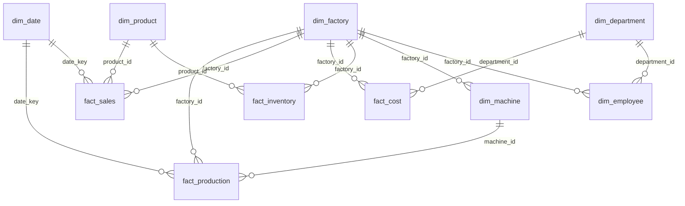

# Database Design — Nexora Analytics

All data synthetic. Employees identified by `employee_code` only — no PII.

**Grain summary**
- `fact_production`: one machine × one day
- `fact_sales`: one product × one factory × one day
- `fact_cost`: one factory × one department × one month
- `fact_inventory`: one product × one factory × one month